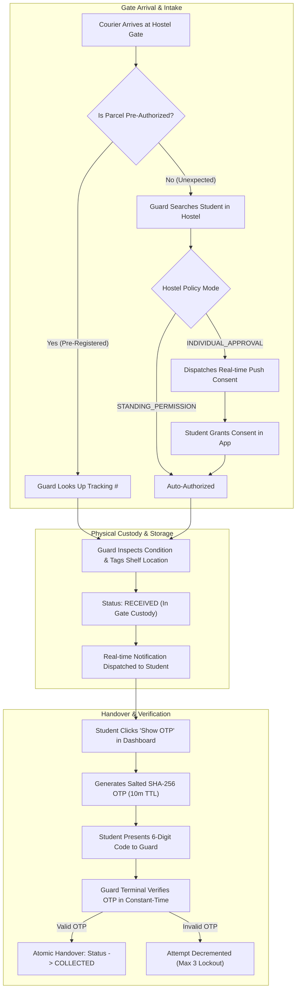

# ParcelTrack 📦
### Hostel Parcel Reception and Secure Handover System

[](https://github.com/mahakagarwal7/ParcelTrack)
[](https://github.com/mahakagarwal7/ParcelTrack)
[](https://nodejs.org/)
[](LICENSE)

---

## 📌 Executive Summary & Problem Statement

College and university hostels handle hundreds of courier deliveries daily (Amazon, Flipkart, BlueDart, Delhivery). Traditional hostel logbooks suffer from:
1. **Unverified Gate Reception**: Guards accept parcels without knowing if the recipient is an enrolled student or has authorized the item.
2. **Parcel Misplacement & Theft**: Without shelf tagging or identity verification, packages are easily stolen or picked up by unauthorized students.
3. **No Chain of Custody**: Lack of immutable timestamps, condition checks, and cryptographic handovers leaves hostels vulnerable to disputes.

**ParcelTrack** is an enterprise-grade MERN system that introduces a verifiable, state-machine governed lifecycle for campus package delivery:
- **Pre-Arrival Authorization**: Students pre-register expected parcels with carrier tracking numbers.
- **Dynamic Hostel Gate Policies**: Configurable per-hostel modes (`INDIVIDUAL_APPROVAL`, `STANDING_PERMISSION`, `HYBRID`) allowing automatic or on-demand student consent for unexpected courier arrivals.
- **Cryptographic Single-Use OTP**: Secure handover verification powered by salted SHA-256 hashes, constant-time equality checks, a 10-minute expiry window, and a 3-attempt brute-force rate limit.
- **Atomic Concurrency Protection**: Atomic conditional MongoDB transitions (`findOneAndUpdate({ status: 'RECEIVED' })`) preventing double-collection race conditions.
- **Zero-Setup Database Runner**: Built-in automated fallback to `mongodb-memory-server` if no local MongoDB instance is running.

---

## 🏗️ System Architecture & Workflow



---

## 🛡️ Core Security Guarantees & Implementation

| Guarantee | Mechanism | Implementation Detail |
|---|---|---|
| **State Invariants** | Finite State Machine (`stateMachine.js`) | Only legal transitions allowed: `REGISTERED`/`AUTHORIZED` → `RECEIVED` → `COLLECTED`. Out-of-order transitions throw `400 Bad Request`. |
| **Atomic Handover** | Conditional Mongo `$set` | `Parcel.findOneAndUpdate({ _id, status: 'RECEIVED' }, { status: 'COLLECTED' })`. Concurrent calls immediately receive `409 Conflict`. |
| **OTP Cryptography** | `crypto.randomInt` + `crypto.timingSafeEqual` | Plaintext OTP is never stored in DB. Evaluated against `SHA-256(otp + salt)` in constant-time to prevent timing attacks. |
| **Brute-Force Rate Limiting** | Max 3 Attempts per OTP | Database tracks invalid attempts. Automatically marks OTP `isUsed: true` upon 3 failed submissions. |
| **Hostel Multi-Tenancy** | Scoped Middleware (`hostelScope.js`) | All database queries and updates are constrained by `req.user.hostelId`. Guards cannot view or release packages from another hostel. |
| **Audit Ledger** | Append-Only `ActivityLog` | Every state transition, gate attempt, policy alteration, and handover is permanently recorded with user ID and timestamp. |

---

## 👥 User Roles & Capabilities

### 🎓 1. Student Portal (`/student`)
- Pre-register expected parcels with carrier and tracking numbers.
- Receive real-time push prompts when an unannounced courier arrives at the hostel gate (Grant / Reject consent).
- Real-time parcel tracking table with shelf storage locations.
- On-demand generation of 6-digit collection OTP when a package is ready for pickup.
- Interactive parcel lifecycle timeline view (`<Timeline />`).

### 🛡️ 2. Security Guard Terminal (`/guard`)
- **Single-Use OTP Verification**: Direct entry of Parcel ID and student OTP for instantaneous verification and handover.
- **Expected Intake Desk**: Quick barcode/tracking number search to admit pre-authorized parcels into storage shelves.
- **Unexpected Courier Desk**: Fast recipient search by student name/room and instant dispatch of consent requests.
- **Active Custody Table**: Real-time list of all packages currently stored in gate racks with condition tracking (`INTACT`, `DAMAGED`, `OPENED`, `TAMPERED`).

### 🏫 3. Hostel Warden Console (`/warden`)
- **Pending Approvals Queue**: Sign-off on parcels flagged for supervisory review.
- **Policy Configuration**: Toggle hostel policy between `INDIVIDUAL_APPROVAL`, `STANDING_PERMISSION`, and `HYBRID`. Set student parcel hoarding thresholds.
- **Student Suspension Manager**: Suspend automatic standing reception permissions for individual students (e.g., for uncollected parcel accumulation).
- **Hostel Audit Trail**: Review immutable log of all gate operations.

### ⚙️ 4. Campus Administrator (`/admin`)
- Campus-wide analytics: active users, total parcels, gate custody counts, and collection throughput.
- User Management: Search, update roles, toggle hostel assignments, and manage account statuses.
- Global Audit Stream: Real-time surveillance of cross-hostel intake operations.

---

## 🔑 Pre-Seeded Demo Accounts (1-Click Login)

The system includes pre-seeded demo accounts with 1-click Quick-Fill buttons on the Login page:

| Role | Email | Password | Notes |
|---|---|---|---|
| **Student** | `student@hostel.edu` | `password123` | Hostel H-1, Room 101 |
| **Student 2** | `student2@hostel.edu` | `password123` | Hostel H-1, Room 102 |
| **Security Guard** | `guard@hostel.edu` | `password123` | Hostel H-1, Gate 1 Desk |
| **Hostel Warden** | `warden@hostel.edu` | `password123` | Hostel H-1 Supervisor |
| **Campus Admin** | `admin@hostel.edu` | `password123` | Campus-Wide Authority |

---

## 🔌 Complete REST API Specification

### Authentication (`/api/auth`)
- `POST /register` — Register student or staff user.
- `POST /login` — Login with email and password (returns JWT & sets cookie).
- `GET /me` — Fetch authenticated profile.
- `POST /logout` — Invalidate session.

### Parcels (`/api/parcels`)
- `POST /` — Student pre-registers upcoming parcel.
- `GET /my` — Student retrieves their parcel history.
- `GET /guard/active` — Guard fetches all parcels currently in gate custody.
- `GET /guard/lookup?trackingNumber=...` — Guard looks up pre-authorized parcel.
- `POST /:id/receive` — Guard admits parcel to physical custody with shelf location.
- `POST /:id/collection-otp` — Student generates single-use 6-digit collection OTP.
- `POST /:id/collect` — Guard verifies OTP and completes handover.
- `GET /:id` — Detailed parcel status inspection and timeline.

### Authorizations & Gate Attempts
- `GET /api/authorizations/pending` — Warden retrieves pending approval queue.
- `POST /api/authorizations/:id/student-decision` — Student grants or rejects gate consent.
- `POST /api/authorizations/:id/warden-decision` — Warden approves or rejects parcel.
- `GET /api/delivery-attempts/students/search?query=...` — Guard directory search.
- `POST /api/delivery-attempts` — Guard logs unannounced courier arrival.
- `POST /api/delivery-attempts/:id/receive` — Guard receives authorized unexpected parcel.

### Hostel Policies & Admin
- `GET /api/hostel/policy` — Retrieve active hostel policy mode.
- `PATCH /api/hostel/policy` — Warden updates policy (`INDIVIDUAL_APPROVAL`, `STANDING_PERMISSION`, `HYBRID`).
- `PATCH /api/hostel/students/:id/suspension` — Warden manages student standing suspensions.
- `GET /api/activity-logs` — Retrieve immutable audit trail.
- `GET /api/admin/stats` — Campus-wide aggregate metrics.
- `GET /api/admin/users` — Directory search and filtering.
- `PATCH /api/admin/users/:id` — Update user permissions and hostel assignments.

---

## 🚀 Quickstart & Setup Guide

### Prerequisites
- Node.js `>= 18.0.0`
- npm `>= 9.0.0`
- *(Optional)* Local MongoDB instance. If unset, ParcelTrack automatically launches an in-memory database!

### 1. Installation
Clone the repository and install dependencies for both backend and frontend:

```bash
git clone https://github.com/mahakagarwal7/ParcelTrack.git
cd ParcelTrack

# Install server and client dependencies
npm run install:all
```

### 2. Seed Demo Database
Populate test accounts, sample parcels, policies, and gate attempts:

```bash
npm run seed
```

### 3. Run Automated Test Suite
Execute the 80 backend unit, integration, and concurrency acceptance tests:

```bash
npm test
```
*Expected output: `Test Suites: 9 passed, 9 total. Tests: 80 passed, 80 total`.*

### 4. Start Development Servers
Run the backend API and the Vite frontend:

```bash
# Terminal 1: Backend Server (runs on http://localhost:5000)
npm run dev:server

# Terminal 2: React Frontend (runs on http://localhost:5173)
npm run dev:client
```

Open `http://localhost:5173` in your browser and use the 1-click Quick-Fill buttons to test all 4 dashboards!

---

## 🧪 Acceptance Test Coverage

The test suite covers 16 comprehensive sections with 80 passing assertions:
1. **Hostel Scoping & Multi-Tenancy**: Verifies that guards from Hostel H-1 cannot release parcels belonging to Hostel H-2.
2. **Double-Collection Invariant**: Simulates simultaneous concurrent OTP handovers and proves that only one succeeds while the duplicate throws `409 Conflict`.
3. **Brute-Force Rate Limiting**: Confirms that submitting 3 invalid OTP attempts locks the token.
4. **State Transitions**: Validates that parcels cannot bypass gate reception directly to collection.
5. **Real-time WebSockets**: Validates room-scoped event delivery (`parcel:updated`, `notification:new`).

---

## 📄 License
This project is open-source and available under the [ISC License](LICENSE).
